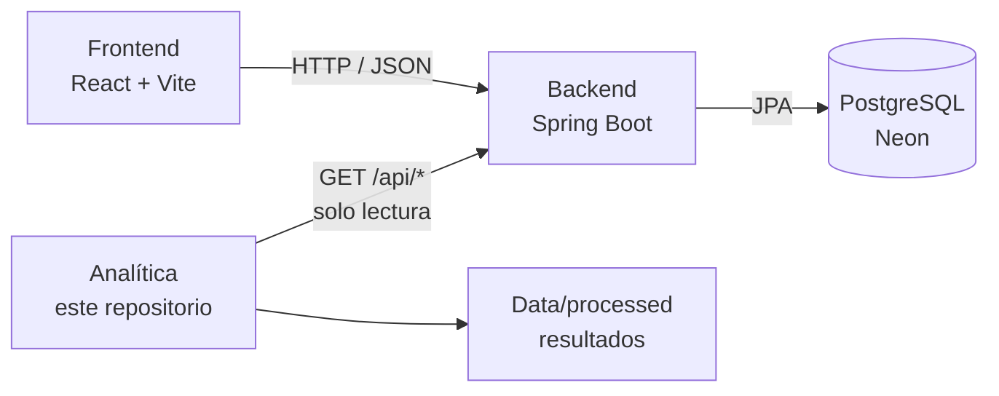

# PetMind Analítica

Programa de análisis de datos de **PetMind**, hecho en Python con Pandas. Descarga los datos de usuarios y favoritos desde una API, los carga en DataFrames, los limpia, los combina y responde preguntas sobre ellos desde un menú en consola.

## PetMind: los 3 repositorios

| Repositorio | Rol | Habla con |
|---|---|---|
| [frontend-petmind](https://github.com/ciroescuderobrayan-SDJ/frontend-petmind) | Interfaz (React + Vite). | Backend, por HTTP/JSON |
| [backend-pet-mind](https://github.com/ciroescuderobrayan-SDJ/backend-pet-mind) | API REST (Spring Boot). Reglas de negocio y persistencia en PostgreSQL. | PostgreSQL (Neon) |
| **petmind-analitica** (este) | Extracción, limpieza y análisis de datos. | Backend, solo lectura |



**Responsabilidad de este repositorio:** extraer, limpiar y analizar. No escribe en la base de datos ni repite reglas de negocio del backend. Sus resultados (datos limpios y respuestas) son para consulta del equipo y, más adelante, para mostrar indicadores.

## Estado actual

Hoy los datos vienen de **MockAPI**, no del backend de PetMind:

- Usuarios: `https://6ac0faa8309c92da039c3567.mockapi.io/api/v1/user`
- Favoritos: `https://6ac0faa8309c92da039c3567.mockapi.io/api/v1/favorite`

Los datos de MockAPI traen errores a propósito (ids negativos, ciudades con símbolos, filas vacías, duplicados) para practicar la limpieza. El paso siguiente es leer del backend (ver [Conexión con el backend](#conexión-con-el-backend)).

## Funcionalidades

- Extracción de datos desde una API y guardado en `Data/raw/` (`user.json`, `favorite.json`).
- Carga de los JSON en DataFrames de Pandas.
- Limpieza:
  - Se elimina la columna `password`: no sirve para el análisis y nunca debe imprimirse.
  - Las fechas (`creation_date`, `last_update`) se convierten a fecha real; las inválidas quedan nulas.
  - Textos vacíos o con solo espacios pasan a nulos; se eliminan filas totalmente vacías.
  - Textos en minúsculas y sin espacios repetidos.
  - Ids inválidos (texto, negativos, decimales, booleanos) pasan a nulos.
  - Se eliminan registros sin campos obligatorios (`id`, `name`, `email` en usuarios; `id`, `id_user` en favoritos).
  - Ciudades solo con letras (`"medellín!!!###"` → `"medellín"`).
  - Ids repetidos y filas duplicadas se eliminan, conservando la primera.
- Combinación de favoritos con el usuario que los marcó (`merge`).
- Consultas:
  1. Usuario con más favoritos.
  2. Cantidad de favoritos por ciudad.
  3. Cantidad de usuarios de Medellín.

## Estructura del proyecto

```text
petmind-analitica/
├── Data/
│   └── raw/                    JSON descargados de la API
│       ├── user.json
│       └── favorite.json
├── src/
│   ├── extract/
│   │   └── fetch_api.py        Opción 1: descarga y guarda los JSON
│   ├── transform/
│   │   ├── cargar_datos.py     Opción 2: JSON → DataFrames
│   │   ├── limpiar_datos.py    Opción 3: limpieza
│   │   └── combinar_datos.py   Opción 5: merge de favoritos y usuarios
│   └── analyze/
│       └── consultas.py        Opción 6: preguntas sobre los datos
├── tests/                      Pruebas automáticas (unittest)
├── analisis.py                 Menú principal
├── requirements.txt
├── .gitignore
└── Readme.md
```

## Requisitos

- Python 3.10 o superior (el menú usa `match`).
- Git.
- Conexión a internet para descargar los datos (opción 1).

## Instalación

```bash
git clone https://github.com/ciroescuderobrayan-SDJ/petmind-analitica.git
cd petmind-analitica
python3 -m venv .venv
```

Activa el entorno virtual:

```bash
# macOS / Linux
source .venv/bin/activate

# Windows
.venv\Scripts\activate
```

Instala las dependencias:

```bash
python -m pip install -r requirements.txt
```

## Ejecución

Con el entorno virtual activo:

```bash
python analisis.py
```

Menú:

```text
1. Traer datos desde la API
2. Cargar datos
3. Limpiar datos
4. Imprimir datos limpios
5. Mergear datos
6. Consultas de datos
0. Salir
```

Orden recomendado: **1 → 2 → 3 → 4 → 5 → 6**. Cada opción avisa si falta el paso anterior.

1. **Traer datos:** descarga `user.json` y `favorite.json` en `Data/raw/`.
2. **Cargar datos:** convierte los JSON en DataFrames.
3. **Limpiar datos:** aplica la limpieza y muestra cuántos registros se eliminaron.
4. **Imprimir datos limpios:** muestra cada DataFrame, los nulos por columna y el total de registros.
5. **Mergear datos:** une favoritos con usuarios por `id_user`. Los ids quedan como `id_favorito` e `id_usuario`.
6. **Consultas:** responde las tres preguntas de la sección Funcionalidades.

## Pruebas automáticas

Usan `unittest`, que viene con Python, así que no hay que instalar nada más:

```bash
python -m unittest -v
```

Cubren la limpieza (ids inválidos, duplicados, ciudades, fechas y contraseñas) y las consultas, incluido el caso sin datos.

## Manejo de errores del menú

- Si la API no responde (opción 1) o faltan los archivos de `Data/raw` (opción 2), el programa avisa y sigue en el menú.
- `Ctrl+C` o `Ctrl+D` cierran el programa. Antes un `except:` vacío los atrapaba y el menú quedaba en un ciclo infinito.

## Conexión con el backend

### Cómo debe quedar

La analítica lee del backend **por la API REST, en modo solo lectura**, igual que el frontend. No se conecta directo a PostgreSQL. Así:

- No necesita las credenciales de la base de datos.
- Ve los mismos datos y las mismas reglas que el resto del sistema (por ejemplo, el backend ya oculta los registros con borrado lógico).

Cambios propuestos, en orden:

1. **URL base configurable.** Leer `PETMIND_API_URL` de un archivo `.env` (por defecto `http://localhost:8080/api`) en lugar de tener las direcciones de MockAPI fijas en `fetch_api.py`.
2. **Nuevos endpoints** en `ENDPOINTS_API`: `/usuarios`, `/favoritos` y, para más análisis, `/mascotas`, `/donaciones`, `/campanas-donacion`, `/solicitudes-adopcion`.
3. **Aplanar el JSON** del backend con `pd.json_normalize`, porque trae objetos anidados (`contacto`, `direccion`, `usuario`...).
4. **Renombrar columnas** a los nombres que ya usa la limpieza, para no reescribirla:

   | Backend (JSON) | Columna en la analítica |
   |---|---|
   | `nombre` | `name` |
   | `apellido` | `last_name` |
   | `contacto.emailContacto` | `email` |
   | `contacto.telefonoPrincipal` | `phone` |
   | `direccion.ciudad` | `city` |
   | `fechaCreacion` | `creation_date` |
   | `usuario.id` (en favoritos) | `id_user` |
   | `mascota.id`, `campana.id`, `fundacion.id` | `id_pet`, `id_campaign`, `id_foundation` |

5. **Guardar resultados** en `Data/processed/` (por ejemplo, `usuarios_limpios.csv`), para que el equipo los consulte sin volver a correr el programa.

> El backend devuelve la contraseña solo en escritura, así que no llega a la analítica. Los datos de MockAPI sí traen un campo `password`: no se debe usar ni imprimir.

### Qué hace cada parte

| Tarea | Dónde |
|---|---|
| Validar datos al crear o editar registros | Backend |
| Limpiar datos históricos o de fuentes externas | Analítica |
| Calcular indicadores (más favoritos, donaciones por mes, adopciones por ciudad) | Analítica |
| Mostrar indicadores en pantalla (más adelante) | Frontend, leyendo un endpoint del backend o un archivo generado aquí |

## Control de versiones

Git Flow:

- `main`: rama estable.
- `dev`: rama de integración del equipo.
- `feature/*`: una rama por funcionalidad, con Pull Request hacia `dev`.
- `release/analisis-v1`: preparación de la entrega.

## Integrantes

- Santiago Varela
- Emmanuel Gómez
- Brayan Ciro

---

Proyecto académico · PetMind · CESDE
